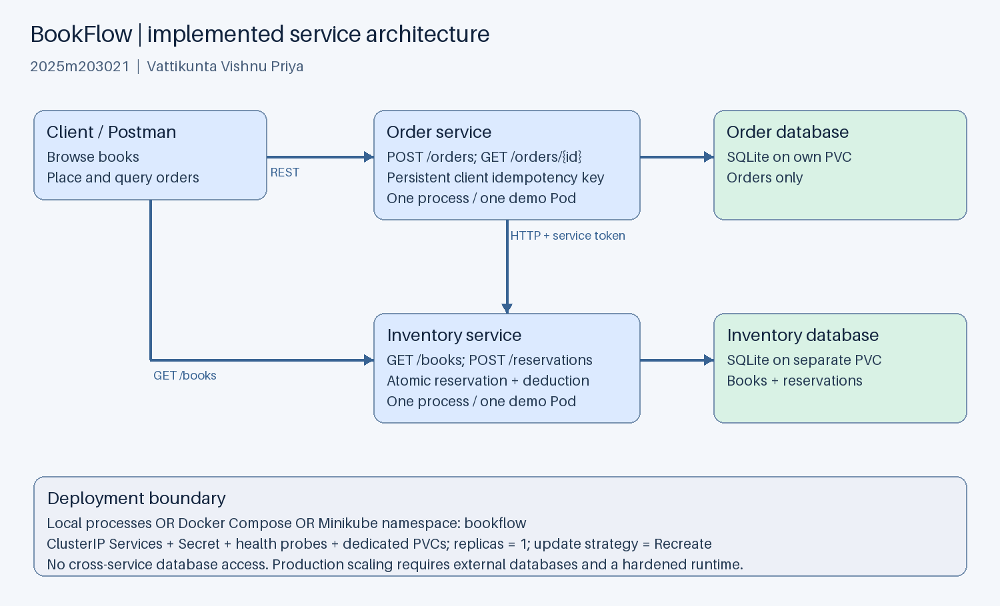
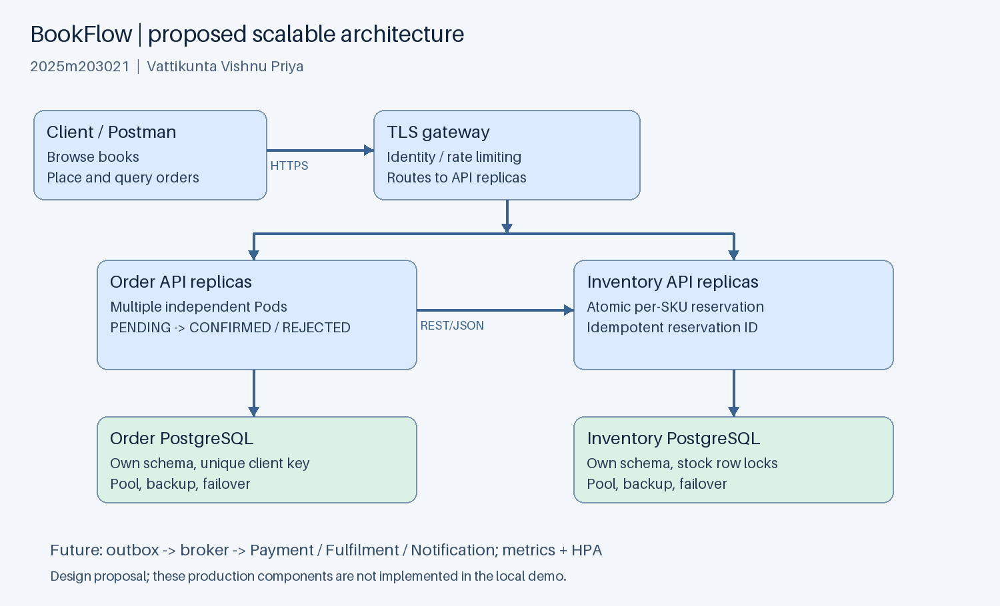
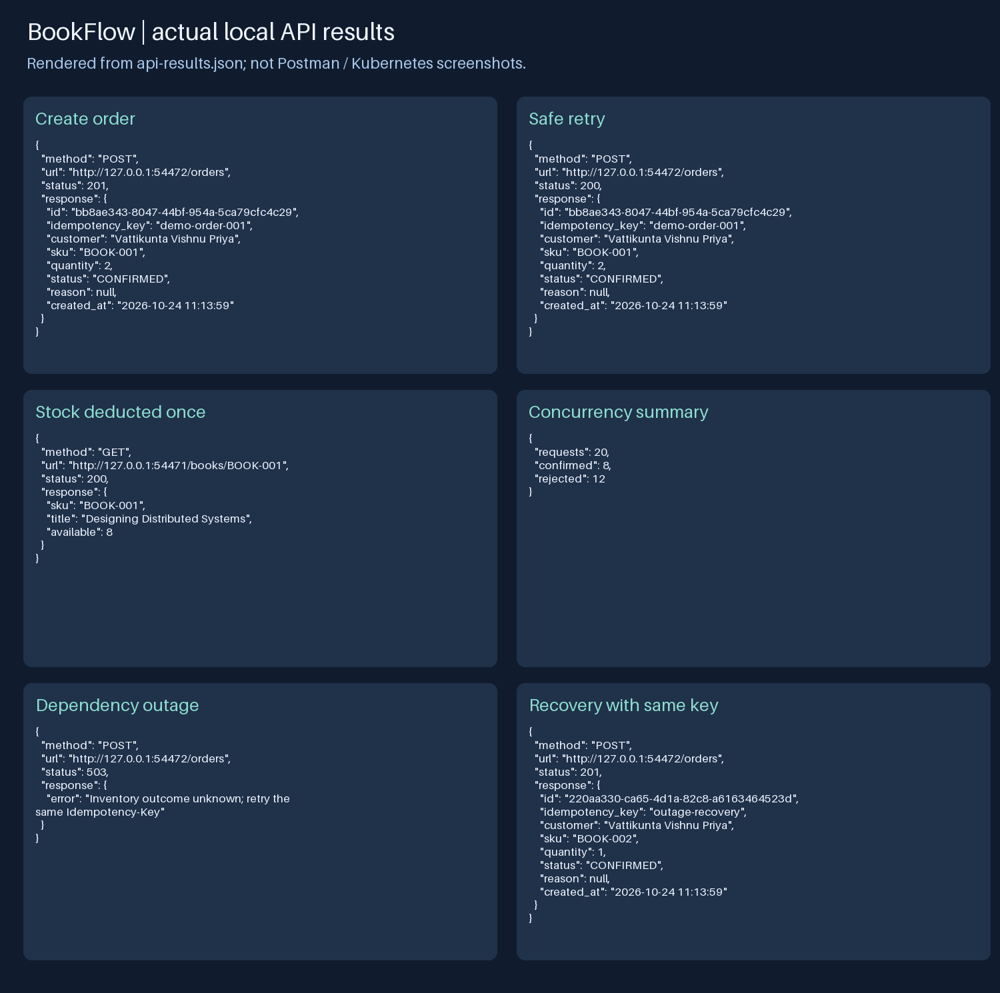

# BookFlow: Microservices Development and Deployment

## 1. Submission details

- Student ID: 2025m203021
- Student name: Vattikunta Vishnu Priya
- Group: Individual; no other members
- Course: SEZG583 Scalable Services
- Assignment: Microservices Development and Deployment
- Submission deadline: 12 November 2026
- Application name: BookFlow
- Submission filename: 2025m203021_BookFlow.zip

## 2. Application description and scope

BookFlow supports a small online bookstore. A customer browses books and places an
order for one book SKU and a positive integer quantity. Orders confirms the order
only after Inventory has durably reserved the stock. Rejected orders retain their
reason. Customers can query orders; staff can inspect available inventory.

The implemented vertical slice contains two services: Order and Inventory. A larger
deployment introduces Identity, Catalog, Payment, Fulfilment and Notification services.
Payment, cancellation, multi-item carts and shipping are outside this implementation.
Book titles and availability are co-located in Inventory only for the teaching slice;
the production Catalog owns searchable metadata. The demo customer field is a label,
not an authenticated identity. The API is intended for local assessment.

## 3. Business capabilities and service boundaries

| Business capability | Service | Owns | Implementation status |
|---|---|---|---|
| Order acceptance and order status | Order | Orders, client idempotency keys, state | Implemented |
| Stock availability and reservation | Inventory | Books, available stock, reservations | Implemented |
| Accounts and authorization | Identity | Users, credentials, roles | Proposed |
| Book search and metadata | Catalog | Titles, authors, search index | Proposed |
| Payment authorization and refunds | Payment | Payment attempts and provider references | Proposed |
| Packing and shipment tracking | Fulfilment | Shipments and delivery state | Proposed |
| Email/SMS status updates | Notification | Templates, delivery attempts | Proposed |

Boundaries follow business ownership. Order never queries Inventory's database;
Inventory never queries Order's database. Each has an independent schema, container,
repository and tests. An inventory schema change can be released independently while
preserving the REST contract. Both common.py copies are local to their repositories.

## 4. System operations: commands and queries

| Type | Operation | Owner | API / collaboration |
|---|---|---|---|
| Query | List available books | Inventory | GET /books |
| Query | Read one book's stock | Inventory | GET /books/{sku} |
| Command | Place order | Order | POST /orders; calls Inventory POST /reservations |
| Command | Reserve stock | Inventory | POST /reservations; service token required |
| Query | Read order | Order | GET /orders/{id} |
| Query | List up to 100 orders | Order | GET /orders |
| Query | Health / readiness | Both | GET /health/live and /health/ready |
| Command | Register / sign in | Identity | Proposed |
| Query | Search catalog | Catalog | Proposed |
| Command | Authorize / refund payment | Payment | Proposed, provider adapter |
| Command | Dispatch shipment | Fulfilment | Proposed, after confirmed payment |
| Command | Send status notification | Notification | Proposed, event consumer |

Business commands alter state; queries read it. Runtime health queries are operational,
separate from the bookstore use case. Stock replenishment is not implemented; seed
data is inserted only on first initialization and never overwrites existing stock.

## 5. Architecture and collaboration



The diagram shows the implemented topology. Solid arrows are synchronous HTTP/JSON;
each service owns its own persistent database. Kubernetes Services provide stable
DNS names inside the namespace. In local mode Order uses 127.0.0.1:8001; Docker and
Minikube use http://inventory:8000. Both services expose port 8000 inside containers;
host demo ports are 8001 and 8002.

### 5.1 Successful order sequence

1. Client POSTs customer, sku and quantity to Order with an Idempotency-Key header.
2. Order validates the fields, creates a PENDING order and commits locally.
3. Order POSTs the order ID, SKU and quantity to Inventory with X-Service-Token.
4. Inventory begins an immediate SQLite transaction. It replays an existing reservation
   or checks stock, inserts a reservation, and deducts stock atomically before commit.
5. Inventory returns RESERVED or REJECTED. Order stores CONFIRMED or REJECTED.
6. Client receives the durable order resource. A same-key same-payload retry returns
   the same order; a changed payload with the same key returns HTTP 409.

### 5.2 Failures, consistency and resilience

There is no cross-service ACID transaction. Inventory's reservation and stock update
are atomic locally. Order's initial PENDING write and later terminal update are local
transactions separated by HTTP. A two-second Inventory timeout bounds dependency wait.
Network failure or upstream 5xx/401 leaves Order PENDING and returns HTTP 503. The client
retries the same key. A crash after a successful reservation is safe because the retry
uses the persisted order ID and Inventory returns its original reservation without
deducting again. This is a reservation workflow with idempotent recovery, not a complete
payment/shipping saga. Exactly-once message delivery is not claimed.

Insufficient stock is a business result: Order creation returns HTTP 201 with status
REJECTED; Inventory's internal reservation returns 409. Unknown SKU also produces a
REJECTED order. A completed order replay returns 200. Quantity validation returns 400;
non-JSON content returns 415; unauthorized reservation requests return 401. A missing
resource returns 404. Overselling is prevented by BEGIN IMMEDIATE plus a nonnegative
stock constraint. Concurrent requests serialize their stock checks and updates.

PENDING recovery currently requires a client retry; an abandoned PENDING order can
remain unresolved. A future reconciliation worker would retry pending rows with backoff.
There is no reservation release or expiration: adding payment/cancellation requires
idempotent compensating release and reservation lifecycle rules.

### 5.3 Scalable production design



Place a TLS gateway/load balancer before multiple stateless Order and Inventory API
replicas. Each service uses its own external PostgreSQL database with pooling,
backups, failover and unique idempotency constraints. Stock reservation must use row
locking or an atomic conditional UPDATE, preserving the same invariants across replicas.
Identity authenticates customers and service accounts; network policies and TLS protect
internal traffic. Catalog can scale search reads independently with an index/cache.

Introduce a broker for OrderConfirmed, PaymentAuthorized, ShipmentDispatched and
NotificationRequested events. An outbox in the publishing service commits state plus
events together; consumers use inbox/deduplication keys. Payment failure triggers an
idempotent release command through an orchestrated saga. Reads use pagination and
appropriate indexes. Apply rate limits, per-call timeouts, bounded retries with jitter,
circuit breakers, structured correlation IDs, metrics, tracing and alerting.

Horizontal Pod Autoscalers can target CPU/utilization once services use external
databases and a metrics provider. API replica counts can then vary independently;
database writes and hot SKUs remain bottlenecks requiring measurement and tuning.
Load-test latency, throughput, lock contention and error rate before choosing targets.
These production components are designed, not implemented or benchmarked in this submission.

The local SQLite demo uses one replica per service and a Recreate strategy to avoid
overlapping writers and ReadWriteOnce volume attachment conflicts. It demonstrates
service boundaries and container orchestration, not high availability or horizontal
scaling. Recreate updates have downtime. A future PostgreSQL migration enables rolling
updates and multiple replicas; increasing demo replicas is not a valid substitute.

## 6. Technology choices

| Concern | Choice | Reason / constraint |
|---|---|---|
| Language | Python 3.13 | Small independently testable implementation |
| REST runtime | ThreadingHTTPServer | Standard library; teaching/local assessment only |
| Data persistence | SQLite, separate file per service | Reproducible demo with atomic transactions |
| Communication | Synchronous REST/JSON, urllib timeout | Immediate reservation outcome; no broker dependency |
| Containerization | Docker, python:3.13-slim | Independent nonroot service images |
| Orchestration | Kubernetes on Minikube | Deployment, Service, Secret, probes and PVC demonstration |
| API exploration | Postman collection | Reproducible requests and response assertions |
| Tests | unittest and real HTTP subprocess tests | No external service dependency for unit suites |
| CI | GitHub Actions | Independent unit suites and image build per repository |

Python's documentation cautions that http.server is not recommended for production.
This assessment runtime should be replaced with an ASGI application/server and hardened
gateway in production. Images use a version tag rather than an immutable digest; a real
release pipeline should pin and scan approved base images. The optional CI configuration
is supplied; a remote Actions run and continuous deployment have not been performed.

## 7. Project structure and database ownership

```text
2025m203021_BookFlow/
  inventory-service/     independent service code repository
    app.py              routes, reservation logic and Inventory schema
    common.py           local HTTP validation and database helpers
    tests/test_inventory.py
    Dockerfile, requirements.txt, README.md
    .github/workflows/ci.yml
  order-service/         independent service code repository
    app.py              routes, order workflow and Order schema
    common.py           local HTTP validation and database helpers
    tests/test_orders.py
    Dockerfile, requirements.txt, README.md
    .github/workflows/ci.yml
  repository-bundles/    portable independent Git histories, when generated
  k8s/                  namespace and workload manifests
  postman/              importable collection with assertions
  tools/                local runner, demo, tests, Minikube script, packaging
  evidence/             actual local responses/test output, diagrams and API panels
  compose.yaml          separate service containers and volumes
  README.md             complete run and troubleshooting instructions
  2025m203021_BookFlow_Report.docx
  2025m203021_BookFlow_Report.md
  2025m203021_Demonstration_Script.md
  2025m203021_FINAL_CHECKLIST.md
```

Inventory schema: books(sku PK, title, available CHECK >= 0); reservations(order_id PK,
sku FK, quantity CHECK > 0, status). Order schema: orders(id PK, idempotency_key UNIQUE,
customer, sku, quantity CHECK > 0, status, reason, created_at). Timestamps are SQLite
CURRENT_TIMESTAMP in UTC. Customer labels and keys are limited to 120 characters;
quantities are integers from 1 to 1000. Booleans are not accepted as integers.
No database files are committed. Demo rows contain no real payment credentials.

## 8. Implementation steps

1. Model the order and reservation boundaries; identify each service's commands/queries.
2. Define JSON contracts and terminal/PENDING state transitions.
3. Implement service-owned schemas and transactional reservation logic.
4. Persist Order before HTTP and add same-key recovery for uncertain outcomes.
5. Add validation, service-token checks, health endpoints and upstream timeout handling.
6. Implement isolated unit suites and two-process HTTP integration checks.
7. Supply independent Dockerfiles, local Compose orchestration and Kubernetes manifests.
8. Prepare Postman requests, deployment instructions, architecture figures and evidence.

## 9. Execution instructions and deployment plan

See README.md for copyable PowerShell commands. For native execution run
./tools/run-local.ps1 and, from another terminal, python tools/demo.py. The local runner
uses persistent service-local data directories and stops its child processes on Ctrl+C.
For isolated verification use python tools/verify.py; it starts fresh temporary databases,
chooses free ports and stops all child processes after the run.

For Docker set SERVICE_TOKEN in the shell and run docker compose up --build -d.
Inventory must pass its readiness healthcheck before Compose starts Order. Named
volumes persist independent database files. Ports bind only to localhost.

For Kubernetes install the three prerequisites and run ./tools/deploy-minikube.ps1.
The script starts the bookflow profile, builds images inside that cluster, creates
the namespace and token Secret, applies the manifests and waits for deployments.
Each deployment requests 100m CPU/64Mi memory and limits 500m CPU/256Mi memory; these
are initial demo settings, not measured production capacity. Each receives a dedicated
1Gi ReadWriteOnce PVC. Containers run as UID 10001 with a read-only root filesystem,
privilege escalation disabled and Linux capabilities dropped; /data is writable.

Startup/readiness probes test the local database; liveness tests the HTTP process.
Order readiness deliberately does not depend on Inventory, so dependency outages
produce explicit API 503s without removing otherwise healthy Order pods from service.
The database readiness test verifies connection/query execution, not a full write test.
ClusterIP services stay internal. For assessment use separate localhost port-forwards;
no internet ingress is configured. Kubernetes Secrets are not automatically encrypted
at rest by this configuration. Do not publish live tokens.

## 10. Testing and captured evidence

The included evidence/test-results.txt records 14 passing unit tests, split evenly
between services, and a passing real two-service HTTP integration run. Coverage includes
idempotent replay, mismatched keys, insufficient stock, unknown SKU, invalid quantities,
timeout recovery, restart persistence and concurrent stock reservation.

In the HTTP run, BOOK-001 began with stock 10. Ordering quantity 2 produced CONFIRMED;
replaying the same key kept stock at 8. Twenty concurrent one-unit orders then produced
8 confirmations and 12 rejections, leaving stock at zero. Inventory was stopped, a
new order returned 503 and persisted PENDING, and restarting Inventory followed by
same-key retry confirmed that order. No performance or production-scale claim follows
from these correctness checks.



The panel above is rendered from actual evidence/api-results.json, with ephemeral local
ports. It is not a Postman screenshot or a Kubernetes deployment screenshot. Requests,
status codes and responses are available in that JSON for inspection. Import the
included collection to capture actual Postman screenshots of the same workflow.

### 10.1 Deployment evidence still to capture

Docker, kubectl, Minikube, GitHub CLI and a screen recording tool were not available
on the preparation machine's PATH. Container image builds and cluster execution were
not performed. The manifests and commands are provided for execution on a configured
machine. Replace this paragraph with actual run details after executing them; retain
honest distinctions between measured results and design proposals.

- Add a real Postman screenshot of order creation showing HTTP 201 and CONFIRMED.
- Add a same-key replay and stock query showing exactly one stock deduction.
- Add insufficient-stock and validation responses.
- Add docker compose ps showing two healthy service containers.
- Add Dashboard screenshots for the bookflow namespace: deployments, Pods and PVCs.
- Record observed replica readiness, restart counts, PVC binding, resource usage if
  metrics are enabled, and any warning Events. Do not invent successful observations.
- Add restart/recovery evidence and the demonstration video filename or approved link.

## 11. Kubernetes dashboard analysis guide

Inspect desired versus available replicas (target 1/1 each), readiness (1/1 containers),
image tags and restart counts. Check the two ClusterIP services select the correct
app labels and target port 8000. Confirm each PVC is Bound and service data survives a
Pod restart. Check Events for FailedScheduling, image pull errors, permission failures
or volume attachment errors; correlate failures with Pod logs and probe status.
If metrics are unavailable, report that fact rather than invent CPU/memory observations.
Explain why one local SQLite writer and Recreate updates are used. These are expected
inspection criteria; actual Dashboard observations are pending cluster execution.

## 12. Repository links and CI status

- Inventory GitHub repository: PENDING — upload the separate Inventory repository and add its actual URL.
- Order GitHub repository: PENDING — upload the separate Order repository and add its actual URL.

Both service roots are self-contained. Portable repository bundles, when included,
restore their independent commit histories without relying on the surrounding workspace.
Use the README's clone/push instructions to publish two distinct repositories.
Each CI workflow runs its own unit suite and builds its own Docker image on push/PR.
Successful local tests do not imply a successful remote Actions run. Optional automated
CD has not been implemented.

## 13. Demonstration recording

Follow 2025m203021_Demonstration_Script.md for a roughly 5–7 minute screen recording.
Show identity, architecture, independent repositories, container deployment, Minikube,
Dashboard, successful and rejected API calls, replay, and restart persistence.
Video status: PENDING — add 2025m203021_BookFlow_Demo.mp4 after recording a real deployment.
A script or rendered API panel does not fulfil the screen-recording requirement.

## 14. References

- Python HTTP server documentation: https://docs.python.org/3.13/library/http.server.html
- Python SQLite documentation: https://docs.python.org/3.13/library/sqlite3.html
- Docker Compose startup order: https://docs.docker.com/compose/how-tos/startup-order/
- Kubernetes probes: https://kubernetes.io/docs/tasks/configure-pod-container/configure-liveness-readiness-startup-probes/
- Kubernetes persistent volumes: https://kubernetes.io/docs/concepts/storage/persistent-volumes/
- Kubernetes autoscaling: https://kubernetes.io/docs/concepts/workloads/autoscaling/horizontal-pod-autoscale/
- Minikube image building/loading: https://minikube.sigs.k8s.io/docs/handbook/pushing/
- Minikube Dashboard: https://minikube.sigs.k8s.io/docs/handbook/dashboard/

The implementation was prepared specifically for this assignment with AI assistance.
References informed API/runtime and deployment choices. The student should review,
understand and adapt the implementation and disclose assistance as required by course
policy. No claim is made that externally hosted repositories, deployment screenshots
or a demonstration recording already exist.
