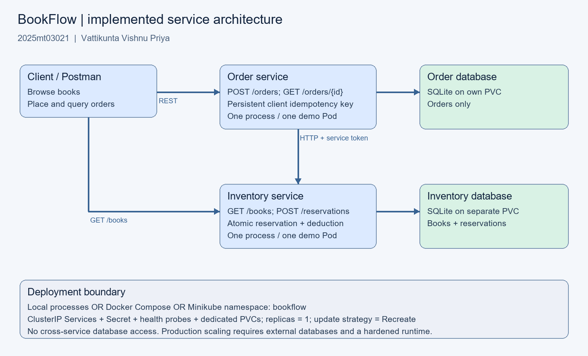

# BookFlow

A bookstore ordering application with two independently runnable Python microservices. Order owns order state; Inventory owns books, stock and reservations. They communicate over REST/JSON and use separate databases.

**Vattikunta Vishnu Priya · 2025mt03021 · SEZG583 Scalable Services**

[Demonstration video](https://drive.google.com/file/d/1kozwYrGsdWq-ezpwBgo2dNM3SF3yEpe2/view?usp=drive_link) · [Postman collection](postman/2025mt03021_BookFlow.postman_collection.json)

## Architecture



| Service | Responsibilities | Local URL |
| --- | --- | --- |
| Inventory | List books, read stock, reserve stock atomically | `http://127.0.0.1:8001` |
| Order | Create orders, recover pending orders, query status | `http://127.0.0.1:8002` |

Order saves a `PENDING` order before requesting a reservation. It then records `CONFIRMED` or `REJECTED`. Replaying the same `Idempotency-Key` and payload returns the original order without deducting stock again. Inventory's transaction prevents competing requests from overselling.

## Project structure

```text
inventory-service/     API, database schema, unit tests and Dockerfile
order-service/         API, database schema, unit tests and Dockerfile
k8s/                   Namespace, deployments, services and persistent volumes
postman/               Importable API collection and assertions
evidence/              Screenshots, diagrams and actual test/API results
.github/workflows/     CI for both services
compose.yaml           Docker Compose configuration
```

Each service contains its own runtime files and tests, without sibling imports. This project repository groups both services; directory separation alone does not satisfy a requirement for separately hosted repositories.

## Run with Docker

Prerequisites: Docker Desktop running with Linux containers and Compose v2. Run commands from this repository root. Ports 8001 and 8002 must be free.

Set the service token in **PowerShell**:

```powershell
$env:SERVICE_TOKEN = [guid]::NewGuid().ToString('N')
```

Or in **macOS/Linux**:

```bash
export SERVICE_TOKEN="$(python3 -c 'import secrets; print(secrets.token_hex(32))')"
```

Start the services:

```bash
docker compose up --build -d
docker compose ps
```

Check [Inventory](http://127.0.0.1:8001/books) and [Order readiness](http://127.0.0.1:8002/health/ready). Import the supplied Postman collection and run requests in numbered order.

```bash
docker compose logs --tail=50
docker compose down
```

Named volumes preserve data between runs. Initial stock is 10 for `BOOK-001` and 5 for `BOOK-002`; repeated orders consume that stock.

## API example

Send `POST http://127.0.0.1:8002/orders` with `Content-Type: application/json` and `Idempotency-Key: bookflow-demo-001`:

```json
{
  "customer": "Vattikunta Vishnu Priya",
  "sku": "BOOK-001",
  "quantity": 2
}
```

With available stock, the response is HTTP 201 with status `CONFIRMED`. Repeat the identical request to receive HTTP 200 and the same order ID. Use a new key for a new order. The collection's **Place order** script generates a fresh key; use **Replay same order** to demonstrate a retry.

| Method | Endpoint | Service |
| --- | --- | --- |
| GET | `/books`, `/books/{sku}` | Inventory |
| POST | `/reservations` (requires `X-Service-Token`) | Inventory |
| POST | `/orders` (requires `Idempotency-Key`) | Order |
| GET | `/orders`, `/orders/{id}` | Order |
| GET | `/health/live`, `/health/ready` | Both |

Insufficient stock creates a stored `REJECTED` order with HTTP 201. Invalid quantities return 400; changing a payload under an existing key returns 409. An unavailable Inventory dependency returns 503 with the order left `PENDING`; retry the same key to recover.

## Tests and CI

Python 3.13 is sufficient; no third-party runtime packages are required. Run the suites independently:

```bash
cd inventory-service
python -m unittest discover -s tests -v
cd ../order-service
python -m unittest discover -s tests -v
```

Use `python3` on macOS/Linux if needed. There are 14 unit tests covering concurrent reservation, replay, payload conflicts, validation, rejection and failure recovery. Order tests mock Inventory; both suites use temporary databases.

The root CI workflow runs both service suites and builds both Docker images. Captured preparation-time verification is included in [test-results.txt](evidence/test-results.txt) and [api-results.json](evidence/api-results.json). The earlier integration run confirmed eight of twenty competing orders against eight remaining copies, with twelve rejections and no overselling. Its temporary runner is not included.

## Kubernetes on Minikube

Install Docker Desktop, kubectl and Minikube. Stop Compose before using the same host ports:

```bash
docker compose down
minikube start -p bookflow --driver=docker --cpus=2 --memory=3072
minikube -p bookflow image build -t bookflow-inventory:1.0 ./inventory-service
minikube -p bookflow image build -t bookflow-orders:1.0 ./order-service
kubectl --context bookflow apply -f k8s/namespace.yaml
```

On the first deployment, create the Secret using the token set above. Preserve an existing Secret on subsequent deployments.

PowerShell:

```powershell
kubectl --context bookflow -n bookflow create secret generic service-auth --from-literal=token="$env:SERVICE_TOKEN"
```

macOS/Linux:

```bash
kubectl --context bookflow -n bookflow create secret generic service-auth --from-literal=token="$SERVICE_TOKEN"
```

Deploy and inspect:

```bash
kubectl --context bookflow apply -f k8s/workloads.yaml
kubectl --context bookflow -n bookflow rollout status deployment/inventory --timeout=180s
kubectl --context bookflow -n bookflow rollout status deployment/orders --timeout=180s
kubectl --context bookflow -n bookflow get deployments,pods,services,pvc
```

Keep each port-forward running in a separate terminal:

```bash
kubectl --context bookflow -n bookflow port-forward service/inventory 8001:8000
```

```bash
kubectl --context bookflow -n bookflow port-forward service/orders 8002:8000
```

Open the Dashboard in another terminal and select namespace **bookflow**:

```bash
minikube -p bookflow dashboard
```

Expect one available Pod per deployment and two Bound 1Gi PVCs. The submission report is distributed separately and includes analysis of the captured Dashboard views.

## Evidence

| Evidence | Link |
| --- | --- |
| Successful order | [Postman confirmation](evidence/2025mt03021_postman_confirmed.png) |
| Inventory query | [Stock after ordering](evidence/2025mt03021_postman_replay_and_stock.png) |
| Rejected order | [Insufficient stock](evidence/2025mt03021_postman_rejected.png) |
| Docker | [Healthy containers](evidence/2025mt03021_docker_containers.png) |
| Kubernetes | [Deployments](evidence/2025mt03021_kubernetes_deployments.png), [Pods](evidence/2025mt03021_kubernetes_pods.png), [PVCs](evidence/2025mt03021_kubernetes_pvc.png) |
| Inventory restart | [Successful rollout](evidence/2025mt03021_restart_persistence.png) |

Student-ID labels in five screenshot presentation copies were corrected to `2025mt03021` using image editing, as noted in the report. The stock-query screenshot shows inventory rather than an explicit replay response; the restart screenshot shows pre-restart stock and rollout completion. The generated API panel summarizes captured local responses.

## Scope

This is a local assessment implementation using `ThreadingHTTPServer` and a separate SQLite database per service. The Kubernetes demo runs one replica per service with `Recreate` updates; it is not a production availability or horizontal-scaling demonstration. PENDING recovery needs a client retry. Payments, customer authentication, cancellation and background reconciliation are outside this implementation.

The [proposed scalable design](evidence/2025mt03021_scalable_design.png) describes external PostgreSQL databases and multiple API replicas; those components are not implemented here.
